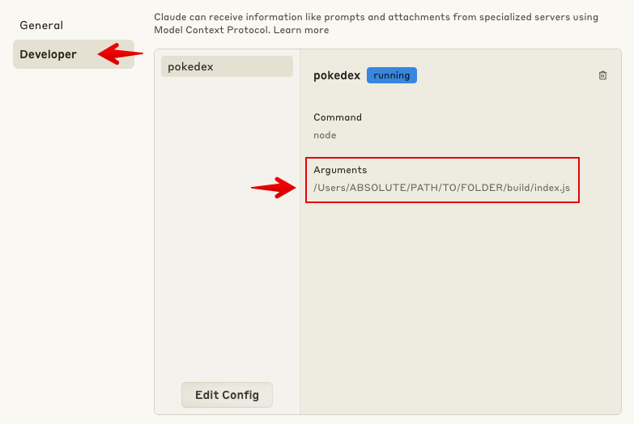
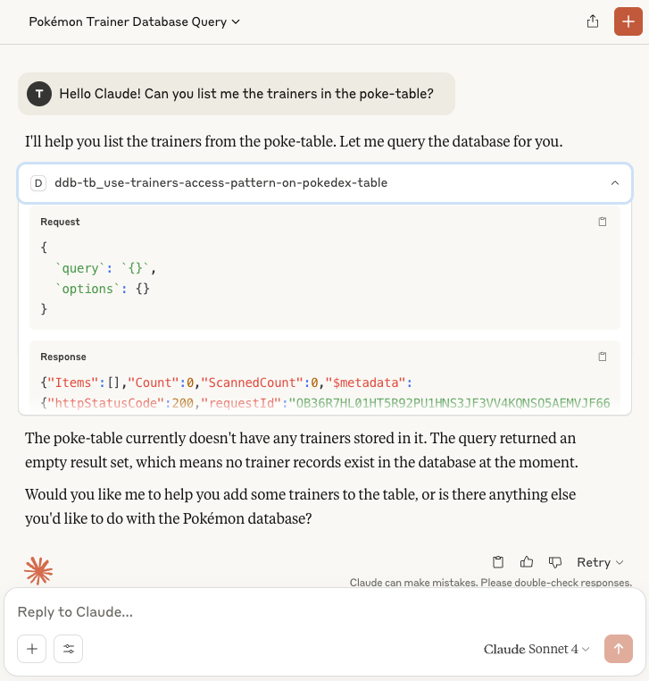
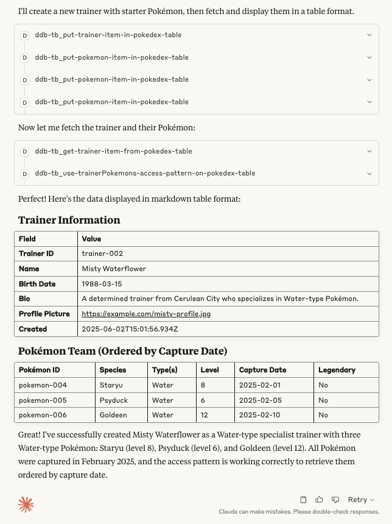

**MCP Clients** are rapidly gaining traction, making backend interactions more intuitive and powerful than ever!

However, integrating them with a database like [DynamoDB](https://aws.amazon.com/dynamodb/) can be challenging. DynamoDB’s schema-less design makes schema discovery and querying difficult, and its strict reliance on well-defined access patterns means that even a small misstep can break your application.

Enter [DynamoDB-Toolbox](https://www.dynamodbtoolbox.com/) — a **lightweight** and **type-safe** query builder for DynamoDB. It already knows everything about your table schemas and access patterns, so why not use that to supercharge your MCP Server?

Well, now you can! Thanks to the new [MCPTookit](https://www.dynamodbtoolbox.com/docs/databases/actions/mcp-toolkit) feature, you can launch a fully functional MCP Server in _just one line of code_ — ready to query and insert data with zero extra setup 🙌

The best part? Your MCP Server is:

- **Smart**: Runs only efficient, fast, and cost-effective queries
- **Robust**: Catches bad input before it ever hits your database
- **DRY**: All the power, one line of code

Let’s dive into a real-world example and see how DynamoDB-Toolbox can power up your MCP Server in no time.

---

## 1. Preparing our Models

This section focuses on model definition, not LLMs. If you’re already using DynamoDB-Toolbox, feel free to skip ahead. Otherwise, it’s a great way to learn how the Toolbox works :)

We’ll model a **Pokedex** with two entities — `Trainer` and `Pokemon` — with the following requirements:

- Query all trainers efficiently, ordered by `birthDate`
- List all Pokemons for a specific trainer, ordered by `captureDate`

We’ll use a **Single Table Design**, using only a partition key in the primary index but a composite key in a GSI.

### Create a Table

First, let’s **create a table** in AWS. Here’s an example using the [AWS CDK](https://aws.amazon.com/cdk/):

```ts
import { AttributeType, TableV2 } from 'aws-cdk-lib/aws-dynamodb';

new TableV2(app, 'PokeTable', {
  tableName: 'poke-table',
  partitionKey: { name: 'PK', type: AttributeType.STRING },
  globalSecondaryIndexes: [
    {
      indexName: 'GSI1',
      partitionKey: { name: 'GSI1_PK', type: AttributeType.STRING },
      sortKey: { name: 'GSI1_SK', type: AttributeType.STRING },
    },
  ],
});
```

### Create a DynamoDB-Toolbox `Table` Instance

```ts
import { DynamoDBClient } from '@aws-sdk/client-dynamodb';
import { DynamoDBDocumentClient } from '@aws-sdk/lib-dynamodb';
import { Table } from 'dynamodb-toolbox/table';

const documentClient = DynamoDBDocumentClient.from(new DynamoDBClient());

const PokeTable = new Table({
  name: 'poke-table',
  partitionKey: { name: 'PK', type: 'string' },
  indexes: {
    GSI1: {
      type: 'global',
      partitionKey: { name: 'GSI1_PK', type: 'string' },
      sortKey: { name: 'GSI1_SK', type: 'string' },
    },
  },
  meta: {
    title: 'Pokedex',
    description: 'Single Table containing Trainers and their Pokemons',
  },
  documentClient,
});
```

### Define Schemas and Entities

Example for the `Trainer` entity:

```ts
import { Entity } from 'dynamodb-toolbox/entity';
import { item, string } from 'dynamodb-toolbox/schema';

const TrainerEntity = new Entity({
  name: 'trainer',
  table: PokeTable,
  schema: item({
    trainerId: string().key().savedAs('PK'),
    name: string(),
    birthDate: string(),
    bio: string().optional(),
    profilePictureUrl: string(),
  }).and(prevSchema => ({
    GSI1_PK: string().default('trainers').hidden(),
    GSI1_SK: string()
      .link<typeof prevSchema>(({ birthDate }) => birthDate)
      .hidden(),
  })),
  meta: {
    title: 'Trainer',
    description: 'Represents a Trainer',
  },
});
```

And for the `Pokemon` entity:

```ts
import { Entity } from 'dynamodb-toolbox/entity';
import { item, string, number, boolean, list } from 'dynamodb-toolbox/schema';

const PokemonEntity = new Entity({
  name: 'pokemon',
  table: PokeTable,
  schema: item({
    pokemonId: string().key().savedAs('PK'),
    species: string(),
    pokeTypes: list(string()),
    level: number(),
    legendary: boolean().optional(),
    trainerId: string().optional(),
    captureDate: string().optional(),
  }).and(prevSchema => ({
    GSI1_PK: string()
      .optional()
      .link<typeof prevSchema>(
        ({ trainerId }) => `trainers/${trainerId}/pokemons`,
      )
      .hidden(),
    GSI1_SK: string()
      .optional()
      .link<typeof prevSchema>(({ captureDate }) => captureDate)
      .hidden(),
  })),
  meta: {
    title: 'Pokemon',
    description: 'Represents a Pokemon. Can be wild or captured.',
  },
});
```

### Create Access Patterns

Now let’s define two [Access Patterns](https://www.dynamodbtoolbox.com/docs/entities/actions/access-pattern) based on our requirements:

```ts
import { any } from 'dynamodb-toolbox/schema';
import { AccessPattern } from 'dynamodb-toolbox/entity/actions/accessPattern';

const trainersAccessPattern = TrainerEntity.build(AccessPattern)
  .schema(any())
  .pattern(() => ({ index: 'GSI1', partition: 'trainers' }))
  .meta({
    title: 'Query all trainers',
    description: 'Returns all trainers (paginated)',
  });

const trainerPokemonsAccessPattern = PokemonEntity.build(AccessPattern)
  .schema(string())
  .pattern(trainerId => ({
    index: 'GSI1',
    partition: `trainers/${trainerId}/pokemons`,
  }))
  .meta({
    title: 'Trainer’s Pokemons',
    description:
      'Returns all Pokemons for a given trainer, ordered by capture date (paginated)',
  });
```

---

## 2. Launch Your MCP Server

Now that our `Table`, `Entities`, and `AccessPatterns` are ready, we're almost ready to launch our MCP Server!

### Define a `Database`

Let’s bundle everything using the [`Registry`](https://www.dynamodbtoolbox.com/docs/tables/actions/registry) and [`Database`](https://www.dynamodbtoolbox.com/docs/databases/usage) features:

```ts
import { Registry } from 'dynamodb-toolbox/table/actions/registry';
import { Database } from 'dynamodb-toolbox/database';

const PokeTableRegistry = PokeTable.build(Registry)
  .registerEntities(TrainerEntity, PokemonEntity)
  .registerAccessPatterns({
    trainers: trainersAccessPattern,
    trainerPokemons: trainerPokemonsAccessPattern,
  });

const PokeDB = new Database({
  pokedex: PokeTableRegistry,
  // Add more table registries here if needed
});

// Example usage:
PokeDB.tables.pokedex.entities.pokemon;
PokeDB.tables.pokedex.accessPatterns.trainers.query(...);
```

### Authenticate to AWS

For local development, we’ll run a [local MCP server](https://modelcontextprotocol.io/quickstart/server), but you can also deploy over HTTP using Frederic Barthelet’s excellent [Middy MCP](https://github.com/fredericbarthelet/middy-mcp) middleware.

To authenticate via your [SSO profile](https://docs.aws.amazon.com/AWSJavaScriptSDK/v3/latest/Package/-aws-sdk-credential-providers/):

```ts
import { fromSSO } from '@aws-sdk/credential-providers';

const dynamoDbClient = new DynamoDBClient({
  region: '<AWS_REGION>',
  profile: '<SSO_PROFILE>',
  credentials: fromSSO(),
});
const documentClient = DynamoDBDocumentClient.from(dynamoDbClient);
```

### Launch the `McpServer`

Finally, let’s launch the [`McpServer`](https://modelcontextprotocol.io/quickstart/server) and use the [`MCPToolkit`](https://www.dynamodbtoolbox.com/docs/databases/actions/mcp-toolkit) Action from DynamoDB-Toolbox to wire everything up:

```ts
import { McpServer } from '@modelcontextprotocol/sdk/server/mcp.js';
import { StdioServerTransport } from '@modelcontextprotocol/sdk/server/stdio.js';

const mcpServer = new McpServer({
  name: 'poke-server',
  version: '1.0.0',
});

// 👇 That's it!
PokeDB.build(MCPToolkit).addTools(mcpServer);

async function main() {
  const transport = new StdioServerTransport();
  await mcpServer.connect(transport);
  console.log('Poke-MCP Server running on stdio');
}

main().catch(error => {
  console.error('Fatal error:', error);
  process.exit(1);
});
```

You’re now ready to interact with your DynamoDB tables using natural language!

---

## 3. Run Your MCP Client 🙌

I used [Claude](https://claude.ai/) as the client. Just add your new Tool in the settings and restart the client.



Now we can query trainers, list Pokemons, and insert data — all interactively!



Claude was able to connect to DynamoDB 🙌 There are no trainers yet, but you can ask it to create one with some starter Pokemons:



---

## Conclusion

With the new [MCPToolkit](https://www.dynamodbtoolbox.com/docs/databases/actions/mcp-toolkit), spinning up a fully functional MCP Server takes just a single line of code — instantly ready to handle queries and data insertion without any extra hassle 🙌

What makes this MCP Server stand out?

- **Smart**: Executes only the most efficient, fast, and cost-effective queries
- **Robust**: Validates inputs to keep bad data from reaching your database
- **DRY**: Packs all this power into just one simple line of code

Together, DynamoDB-Toolbox and MCP Clients simplify working with DynamoDB like never before. Try it out and experience a backend that’s both powerful and effortless!

Now go catch ’em all — and let your AI Assistant help! 🧠🎮
